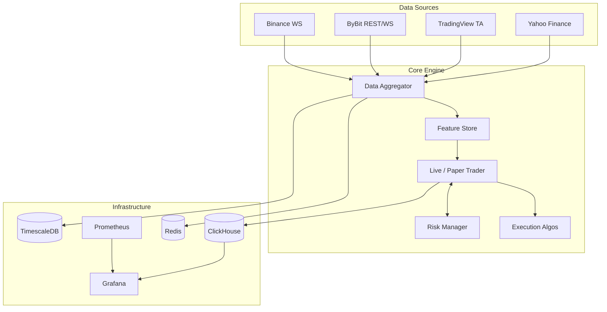

# 🚀 Crypto Risk Engine & Execution Architecture

[](https://github.com/EmreCoskuner5/crypto-risk-engine/actions)
[](https://opensource.org/licenses/MIT)
[](https://www.python.org/downloads/)
[](#)
[](#-test-suite)

An institutional-grade, fully asynchronous Cryptocurrency Trading, Risk Management, and Execution architecture. Built for high-frequency data ingestion, real-time risk assessment, robust backtesting, and bulletproof automated execution.

---

## 🏗️ System Architecture

Our platform adopts a decoupled microservices-inspired architecture, separating data ingestion, risk processing, and database storage to eliminate bottlenecks during extreme market volatility.



---

## 🔥 Key Features

### 1. Advanced Risk Engine (`RiskManager`)
- **Real-Time Mark-to-Market:** Continuously tracks floating PnL across multiple open positions.
- **Daily Drawdown Limits & Midnight Resets:** Hard 3% daily loss limit based on Mark-to-Market equity. Baseline automatically resets at UTC midnight via `_maybe_reset_daily()` to avoid false circuit breakers from previous session drawdowns.
- **Consecutive Loss Pause:** Pauses trading automatically for 1 hour upon 3 consecutive losses.
- **Stablecoin Depeg Circuit Breaker:** Monitors `USDT/USD` spot pricing in real-time. If USDT drops below `$0.95`, the system triggers an emergency `HALT`, liquidates exposure into fiat, and pauses trading.

### 2. Triple-Confirmation Signal Regime
Entries require **3 independent confirmations** before capital is deployed:
1. **Volatility Filter (`vol_regime < 2`):** Bollinger Band Width confirmation (blocks entries during untamed volatility expansions).
2. **Trend Alignment:** EMA(20) vs EMA(50) directional alignment.
3. **Order Book Imbalance (OBI) & Momentum:** Aggression delta alignment (`obi > +0.05` for LONG, `obi < -0.05` for SHORT).

### 3. Institutional Database & Observability Stack
- **TimescaleDB:** Real-time ingestion of OHLCV and tick-level orderbook updates with automated compression policies.
- **ClickHouse:** High-throughput columnar storage for executed trade logs (`trade_logs`), enabling instant query execution and granular performance analytics.
- **Redis:** Sub-millisecond in-memory caching for Order Book Imbalances (OBI).
- **Security Hardened:** All exposed services (Grafana, ClickHouse, Prometheus, Redis) strictly bound to `127.0.0.1` (localhost only) with disabled external CORS embedding.

### 4. Direct Bybit Historical Backtesting Engine
- Zero bloated third-party dependencies — pulls 6–12 months of 1-hour klines directly from Bybit's Linear API.
- Simulates the exact live confirmation filters, trailing stops, taker fees (0.04%), slippage (0.05%), and RiskManager circuit breakers.
- Full offline fallback caching to enable isolated sandbox and CI runs.

---

## 🛠️ Quick Start

### 1. Clone & Configure
```bash
git clone https://github.com/EmreCoskuner5/crypto-risk-engine.git
cd crypto-risk-engine
python3 -m venv venv
source venv/bin/activate
pip install -r requirements.txt
```
*Configure `.env` with your exchange API keys (see `.env.example`).*

### 2. Launch the Infrastructure
Bring up the multi-database and observability stack with a single command:
```bash
docker-compose up -d
```
*(Binds TimescaleDB, ClickHouse, Redis, Prometheus, and Grafana to `127.0.0.1` for local network safety).*

### 3. Run the Backtester (6–12 Months Bybit Data)
```bash
# Run 12-month Bybit 1h backtest on BTCUSDT
python -m atomic_trader.cli backtest --months=12 --symbol=BTCUSDT
```

### 4. Start Paper or Live Trading
```bash
# Paper trading mode
python -m atomic_trader.cli paper-trade --interval=10

# Live trading on Binance Testnet
python -m atomic_trader.cli live-trade --interval=10
```

---

## 🧪 Test Suite

Comprehensive automated test suite covering risk calculations, daily baseline resets, circuit breakers, signal confirmation regimes, and backtesting mechanics.

```bash
pytest -v tests/
```
```text
============================== 20 passed in 0.34s ==============================
```

---

## 📈 Observability (Grafana)
Head over to `http://127.0.0.1:3000` (Default login: `admin` / `admin`).
The system is pre-provisioned with the **Risk Engine Command Center** dashboard, offering real-time views into:
- Total floating capital & MTM drawdown
- Open positions count & exposure
- Realized PnL & trade logs streaming from ClickHouse

---

## 🛡️ Disclaimer
This software is for educational and research purposes only. Cryptocurrency trading involves substantial risk of loss. Always test rigorously in simulation before risking capital.
